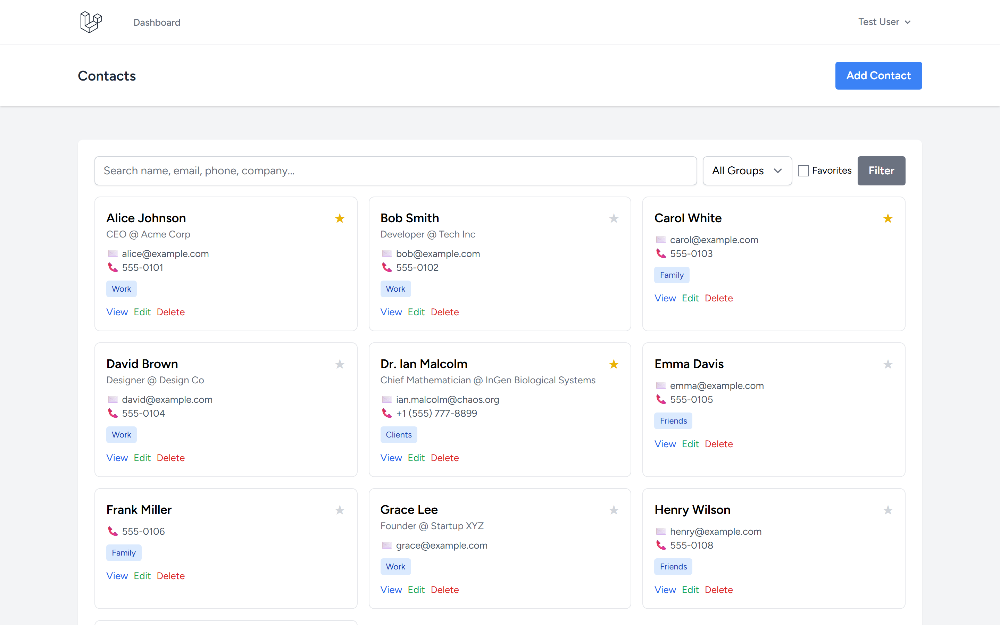
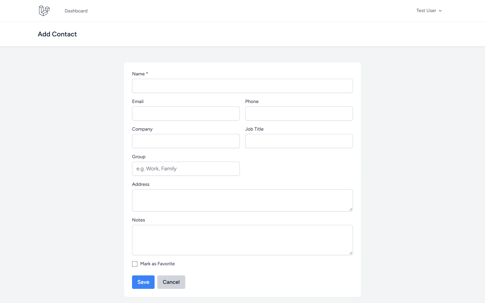
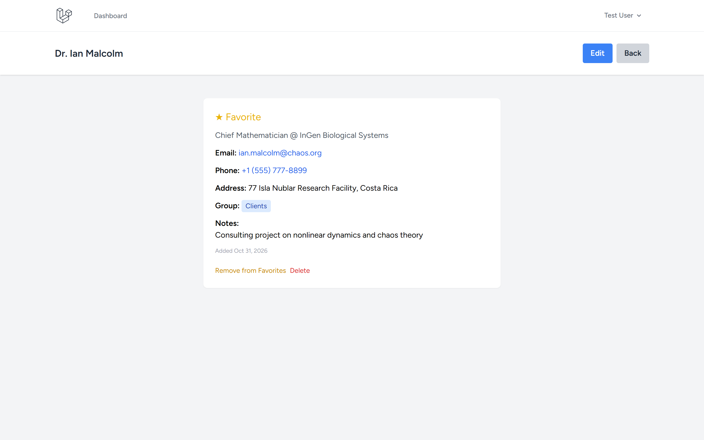
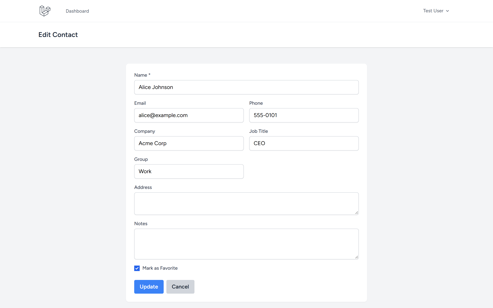

# Contact Management App

CRM-lite contact management with groups, favorites, and search.

Repository: https://github.com/0xyz-exe/contact-management-app-laravel

## Screenshots

| Tampilan | Preview |
|---|---|
| **Direktori Kontak & Filter Grup/Favorit**<br>Tampilan utama buku alamat dengan layout kartu responsif, indikator bintang kontak favorit, label kategori grup (Work, Family, Friends, Clients), dan filter pencarian instan |  |
| **Formulir Penambahan Kontak Baru**<br>Formulir pembuatan kontak baru dengan input nama lengkap, email, nomor telepon, afiliasi perusahaan, jabatan profesional, kategori grup, alamat, dan catatan khusus |  |
| **Detail Profil & Riwayat Catatan Kontak**<br>Halaman profil komprehensif menampilkan informasi kontak, badge status favorit, rincian alamat domisili/kantor, serta catatan konsultasi |  |
| **Manajemen & Pembaruan Data Kontak**<br>Formulir edit data kontak terisi lengkap (pre-filled) dengan validasi authorization policy per-user dan tombol pembaruan profil terintegrasi |  |

## Features

- ✅ Auth (Laravel Breeze)
- ✅ Full CRUD for contacts
- ✅ Search by name, email, phone, company
- ✅ Group filtering (Work, Family, Friends, etc.)
- ✅ Favorites (star/unstar)
- ✅ Policy-based authorization (own contacts only)
- ✅ Card grid layout

## Tech Stack

Laravel 13.38.0 · Breeze 2.4 · SQLite · Tailwind CSS

## Installation

```bash
git clone https://github.com/0xyz-exe/contact-management-app-laravel.git
cd contact-management-app-laravel
composer install && npm install && npm run build
cp .env.example .env && php artisan key:generate
touch database/database.sqlite
php artisan migrate --seed
php artisan serve
```

**Demo:** test@example.com / password — 8 seeded contacts (Work, Family, Friends groups)

## Schema

**contacts**: id, user_id, name, email, phone, company, job_title, address, group, notes, is_favorite, timestamps

## License

MIT
